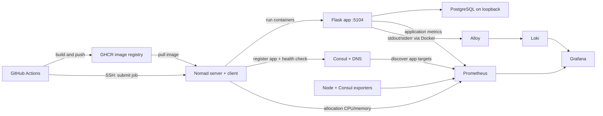

# Ubuntu 24.04 assessment runbook

For one fresh Ubuntu 24.04 server with **2 vCPU / 4 GB RAM**, sudo access, and a public IP. Run commands on Ubuntu unless a step says **on your laptop** or **in GitHub**. These are preparation files; they have not been deployed to your server.

Validation performed locally: all four Nomad jobs passed offline validation with Nomad 2.0.7, and the YAML files parsed successfully. Docker was unavailable locally, so driver validation, container startup, data-source connectivity, and the CI workflow still need the server/rehearsal checks below.

## 1. Understand the target



Nomad and Consul run as systemd services. PostgreSQL, the app, Prometheus, Grafana, Loki, Alloy, and the exporters run as Nomad tasks. Host networking lets these components share `127.0.0.1`. The Nginx troubleshooting example uses Docker port publishing to demonstrate host/container port mapping without requiring Nomad CNI networking.

This is an isolated assessment setup: Nomad/Consul ACLs and TLS are not enabled, and the Docker driver permits host mounts. Keep their APIs on loopback and access them through SSH. Consul KV here is a temporary configuration store, not a production secret manager. Anyone with server access can read its contents. For production, use ACLs, TLS, workload identities and a secret manager.

| Component | Task memory | CPU reservation (MHz) |
|---|---:|---:|
| PostgreSQL | 512 MB | 300 |
| App, one Gunicorn worker | 512 MB | 400 |
| Prometheus | 512 MB | 200 |
| Grafana | 256 MB | 150 |
| Loki | 512 MB | 200 |
| Alloy | 128 MB | 100 |
| Node exporter | 64 MB | 50 |
| Consul exporter | 64 MB | 50 |
| Troubleshooting Nginx | 64 MB | 50 |

Total task memory: **2624 MB**. Reserve **1024 MB** in Nomad for Ubuntu, Docker, Nomad and Consul. These are starting limits for a small demonstration; inspect real usage and adjust if tasks are OOM killed. CPU values are Nomad compute units in MHz, not millicores or fixed percentages.

## 2. Inspect the server and network

```bash
cat /etc/os-release
uname -m
nproc
free -h
df -h /
ip -br address
ip route show default
sudo ss -lntup
```

Use the interface carrying the default route (often `ens3`, `eth0`, or `enp1s0`) in the Nomad config below. Check for existing workloads before installing or replacing configurations. These steps assume a fresh server. Use `x86_64` for the provided CI workflow; on an ARM server change its build platform to `linux/arm64` and configure cross-platform build support in Actions.

In your cloud firewall/security group:

- Permit SSH (TCP 22, or your actual SSH port) from your laptop. The CI deployment step also needs SSH access from its runner; use an allowed runner network, a private network/tunnel, or a trusted self-hosted runner if the provider restricts source IPs.
- Optionally permit TCP 5104 and 8080 from evaluator/laptop IPs for direct browser demos. SSH tunnels work without opening these ports.
- Keep 4646, 4647, 4648, 8500, 8300–8302, 8600, 5432, 9090, 9100, 9107, 3100 and 3000 private.

Docker-published ports can bypass UFW filtering; use the provider firewall for the Nginx published port. Do not enable/reset a firewall in the middle of an SSH session without preserving your SSH rule.

## 3. Install Docker, Nomad, and Consul — Task 1

```bash
sudo apt-get update
sudo apt-get install -y ca-certificates curl gnupg git jq unzip dnsutils openssl
sudo install -m 0755 -d /etc/apt/keyrings
sudo curl -fsSL https://download.docker.com/linux/ubuntu/gpg -o /etc/apt/keyrings/docker.asc
sudo chmod a+r /etc/apt/keyrings/docker.asc

echo "deb [arch=$(dpkg --print-architecture) signed-by=/etc/apt/keyrings/docker.asc] https://download.docker.com/linux/ubuntu noble stable" | sudo tee /etc/apt/sources.list.d/docker.list

curl -fsSL https://apt.releases.hashicorp.com/gpg | sudo gpg --dearmor --yes -o /usr/share/keyrings/hashicorp-archive-keyring.gpg
echo "deb [signed-by=/usr/share/keyrings/hashicorp-archive-keyring.gpg] https://apt.releases.hashicorp.com noble main" | sudo tee /etc/apt/sources.list.d/hashicorp.list

sudo apt-get update
sudo apt-get install -y docker-ce docker-ce-cli containerd.io docker-buildx-plugin docker-compose-plugin nomad consul
sudo systemctl enable --now docker
sudo docker run --rm hello-world
nomad version
consul version
sudo docker version
```

Record versions after rehearsal and use the same package versions for the test when possible. Do not replace an existing Docker installation without inspecting it first.

### Configure Consul

```bash
sudo install -d -o consul -g consul /opt/consul
sudo cp -a /etc/consul.d /etc/consul.d.before-assessment
sudo tee /etc/consul.d/consul.hcl >/dev/null <<'EOF'
datacenter       = "dc1"
node_name        = "assessment-1"
data_dir         = "/opt/consul"
server           = true
bootstrap_expect = 1
bind_addr        = "127.0.0.1"
advertise_addr   = "127.0.0.1"
client_addr      = "127.0.0.1"

ui_config {
  enabled = true
}
telemetry {
  prometheus_retention_time = "60s"
  disable_hostname         = true
}
EOF
sudo install -d /etc/systemd/system/consul.service.d
sudo tee /etc/systemd/system/consul.service.d/assessment.conf >/dev/null <<'EOF'
[Service]
# The packaged unit uses Type=notify. Consul only sends READY after a LAN
# join; this isolated one-node assessment has no peer to join.
Type=simple
ExecStart=
ExecStart=/usr/bin/consul agent -config-file=/etc/consul.d/consul.hcl
EOF
sudo consul validate /etc/consul.d/consul.hcl
sudo systemctl daemon-reload
sudo systemctl enable consul
sudo systemctl reset-failed consul
sudo systemctl restart consul
sudo systemctl is-active consul
consul members
until test "$(curl -fsS http://127.0.0.1:8500/v1/status/leader)" != '""'; do sleep 1; done
curl -fsS http://127.0.0.1:8500/v1/status/leader
consul operator raft list-peers
```

Expected: `active`, one alive Consul server, a nonempty leader address, and one Raft peer in `leader` state. Explicitly loading one config file avoids accidentally merging settings from package examples. The package's `Type=notify` mode is appropriate when agents use `join` or `retry_join`; this isolated single node instead uses `Type=simple`, followed by explicit API readiness checks.

### Configure Nomad

Replace `YOUR_INTERFACE` below with the actual interface from step 2.

```bash
sudo install -d /opt/nomad /root/.docker
sudo cp -a /etc/nomad.d /etc/nomad.d.before-assessment
sudo tee /etc/nomad.d/nomad.hcl >/dev/null <<'EOF'
name       = "assessment-1"
datacenter = "dc1"
data_dir   = "/opt/nomad"
bind_addr  = "127.0.0.1"

advertise {
  http = "127.0.0.1"
  rpc  = "127.0.0.1"
  serf = "127.0.0.1"
}
server {
  enabled          = true
  bootstrap_expect = 1
}
client {
  enabled           = true
  servers           = ["127.0.0.1:4647"]
  network_interface = "YOUR_INTERFACE"
  reserved {
    cpu    = 300
    memory = 1024
  }
}
consul {
  address = "127.0.0.1:8500"
}
telemetry {
  collection_interval        = "5s"
  disable_hostname           = true
  prometheus_metrics         = true
  publish_allocation_metrics = true
  publish_node_metrics       = true
}
plugin "docker" {
  config {
    volumes {
      enabled = true
    }
    auth {
      config = "/root/.docker/config.json"
    }
  }
}
EOF
sudo nano /etc/nomad.d/nomad.hcl
sudo install -d /etc/systemd/system/nomad.service.d
sudo tee /etc/systemd/system/nomad.service.d/assessment.conf >/dev/null <<'EOF'
[Unit]
After=docker.service consul.service
Wants=docker.service consul.service

[Service]
User=root
Group=root
ExecStart=
ExecStart=/usr/bin/nomad agent -config=/etc/nomad.d/nomad.hcl
EOF

# An empty Docker auth file is sufficient for public images initially.
sudo sh -c 'test -f /root/.docker/config.json || printf "{}\n" > /root/.docker/config.json'
sudo chmod 600 /root/.docker/config.json
sudo nomad config validate /etc/nomad.d/nomad.hcl
sudo systemctl daemon-reload
sudo systemctl enable --now nomad
sudo systemctl restart nomad
nomad server members
nomad node status
nomad node status -self -verbose
```

Expected: one leader, one `ready` client, and Docker detected/healthy. The client runs as root to manage Docker and Linux cgroups. Do not use `nomad agent -dev` for this exercise.

If a service fails:

```bash
sudo journalctl -u consul -u nomad -n 100 --no-pager
```

### Access the UIs — on your laptop

Replace the SSH destination; leave this command running in another terminal:

```bash
ssh -N -L 4646:127.0.0.1:4646 -L 8500:127.0.0.1:8500 -L 3000:127.0.0.1:3000 -L 9090:127.0.0.1:9090 -L 5104:127.0.0.1:5104 ubuntu@YOUR_SERVER_IP
```

Open `http://localhost:4646` and `http://localhost:8500`. Later, Grafana is `http://localhost:3000`, Prometheus is `http://localhost:9090`, and Swagger is `http://localhost:5104/docs/`.

**Task 1 gate:** both UIs load, Nomad node is ready, Docker is healthy, Consul has a leader. Take a screenshot.

## 4. Prepare your repository and app — Task 2

Create an empty repository in **your own GitHub account**. Push your local clone to that repository, preserving the original as `upstream` if needed. Inspect `git remote -v` first; do not overwrite an existing remote blindly. Keep these preparation files in your fork so CI can read the Nomad specification.

The supplied staging image uses **5104** and `FLASK_ENV=staging`. It needs PostgreSQL via `DATABASE_URL`. The Compose file is reference material; you do not need to run its entire stack. No Redis calls were found in the application's Python source, so this runbook omits Redis.

### Add readiness and Prometheus metrics before building

Add `prometheus-client` to `requirements/requirements-stage.txt`, then pin the version you successfully rehearse with. Add these imports to `app.py`:

```python
from flask import request
from prometheus_client import Counter, make_wsgi_app
from werkzeug.middleware.dispatcher import DispatcherMiddleware

HTTP_REQUESTS = Counter(
    "hubspot_http_requests_total", "HTTP responses", ["method", "route", "status"]
)
```

Inside `create_app()`, immediately before its `return app`, add:

```python
    @app.route('/ready')
    def ready():
        healthy = check_db_connection()
        return {"database": "healthy" if healthy else "unhealthy"}, 200 if healthy else 503

    @app.after_request
    def count_http_responses(response):
        route = request.url_rule.rule if request.url_rule else "unmatched"
        HTTP_REQUESTS.labels(request.method, route, str(response.status_code)).inc()
        return response

    app.wsgi_app = DispatcherMiddleware(app.wsgi_app, {
        '/metrics': make_wsgi_app()
    })
```

Why add `/ready`? The existing `/scan/health` can return HTTP 200 with a `degraded` database, and `/health-simple` only checks that Flask responds. Neither proves the database is ready. This new check makes Consul health meaningful. Remove the existing `DEBUG: DATABASE_URL` print in `app.py`, which prints credentials into application logs.

Use one Gunicorn worker for this resource-constrained test. Python metrics are process-local by default; more workers require the client's multiprocess setup. The provided Nomad job overrides the image command to use one worker, two request threads, and console access/error logs. The supplied Dockerfile is still used for the build.

Add a `.dockerignore` in the repository root, at minimum:

```text
.git
.env
.env.*
!.env.example
__pycache__
*.pyc
.venv
venv
logs
*.docx
```

### Clone your prepared fork on Ubuntu

```bash
git clone https://github.com/YOUR_ACCOUNT/hubspot-company.git
cd hubspot-company
```

All subsequent relative paths assume this repository root.

### Create persistent directories and temporary configuration

```bash
sudo mkdir -p /opt/assessment/config /opt/assessment/data/{postgres,prometheus,grafana,loki,alloy}
sudo cp docs/nomad-assessment/config/* /opt/assessment/config/
sudo chown 65534:65534 /opt/assessment/data/prometheus
sudo chown 472:472 /opt/assessment/data/grafana
sudo chown 10001:10001 /opt/assessment/data/loki

# Generate secrets without printing them. Do not run with shell tracing enabled.
set +x
DB_PASSWORD=$(openssl rand -hex 24)
APP_SECRET=$(openssl rand -hex 32)
printf 'POSTGRES_USER=hubspot\nPOSTGRES_PASSWORD=%s\nPOSTGRES_DB=hubspot\n' "$DB_PASSWORD" | consul kv put assessment/postgres-env -
printf 'DATABASE_URL=postgresql://hubspot:%s@127.0.0.1:5432/hubspot\nSECRET_KEY=%s\n' "$DB_PASSWORD" "$APP_SECRET" | consul kv put assessment/app-env -
unset DB_PASSWORD APP_SECRET
```

Run secret generation only for a fresh setup. Changing these KV values later does **not** reset the password inside an existing PostgreSQL data directory. PostgreSQL's image initializes credentials only on first initialization.

### Start PostgreSQL first

```bash
nomad job validate docs/nomad-assessment/jobs/postgres.nomad.hcl
nomad job plan docs/nomad-assessment/jobs/postgres.nomad.hcl
nomad job run docs/nomad-assessment/jobs/postgres.nomad.hcl
nomad job status postgres
```

Get its allocation ID from the last command, then check readiness:

```bash
nomad alloc exec -task postgres ALLOCATION_ID pg_isready -U hubspot -d hubspot
```

Wait for `accepting connections` before starting the app.

### Build and deploy the first app image

For the first local rehearsal on Ubuntu:

```bash
sudo docker build -f docker/Dockerfile.staging -t hubspot-company:rehearsal .
nomad job validate -var='image=hubspot-company:rehearsal' docs/nomad-assessment/jobs/app.nomad.hcl
nomad job plan -var='image=hubspot-company:rehearsal' docs/nomad-assessment/jobs/app.nomad.hcl
nomad job run -var='image=hubspot-company:rehearsal' docs/nomad-assessment/jobs/app.nomad.hcl
curl -fsS http://127.0.0.1:5104/ready
curl -fsS http://127.0.0.1:5104/metrics | head
curl -fsS http://127.0.0.1:8500/v1/health/service/hubspot?passing=true | jq
dig @127.0.0.1 -p 8600 hubspot.service.consul A +short
dig @127.0.0.1 -p 8600 hubspot.service.consul SRV +short
```

On a single node, a locally built image is available to its Nomad Docker driver. CI later replaces this with a registry image pinned by digest. Build before starting the monitoring stack to keep memory pressure down.

Prove the endpoint reached via Consul discovery:

```bash
APP_IP=$(dig @127.0.0.1 -p 8600 hubspot.service.consul A +short | head -n 1)
test -n "$APP_IP" && curl -fsS "http://$APP_IP:5104/ready"
```

An A record gives an IP; SRV also supplies the service port. The `.consul` suffix will not automatically resolve in your laptop's browser. These commands query Consul's DNS explicitly; they do not change Ubuntu's DNS resolver.

**Task 2 application gate:** running allocation, database-ready response, app metrics available, healthy Consul registration, A/SRV records, and accessible `/docs/`.

## 5. Automate deployment with GitHub Actions — Task 2

Copy `docs/nomad-assessment/deploy.workflow.yml.example` to `.github/workflows/deploy.yml` in your fork. It builds using `docker/Dockerfile.staging`, publishes to GHCR, smoke-tests against a real temporary PostgreSQL container, then submits the job through SSH. It deploys the exact image digest built by that run.

Set these GitHub repository Actions secrets:

| Secret | Value |
|---|---|
| `DEPLOY_HOST` | Server public IP/DNS |
| `DEPLOY_USER` | Ubuntu SSH username |
| `SSH_PRIVATE_KEY` | Dedicated deployment key's private part |
| `SSH_KNOWN_HOSTS` | Verified server SSH host-key entry |

Generate a dedicated deployment key on your laptop and add its public key to the Ubuntu user's `~/.ssh/authorized_keys`. Collect the known-host entry with `ssh-keyscan -H YOUR_SERVER_IP`, then verify its fingerprint against the server's `/etc/ssh/ssh_host_ed25519_key.pub` through your trusted existing session before saving it as a secret. Use normal SSH port 22 for this example; customize both `ssh` and `scp` options if yours differs.

If the GHCR package is private, give the server a GitHub token with **read:packages** access to that package. Log in interactively on Ubuntu:

```bash
sudo docker login ghcr.io --username YOUR_GITHUB_ACCOUNT
```

Enter the token at the prompt. Nomad's Docker driver reads the root Docker auth file configured in step 3. Do not embed the token in the job or workflow. GitHub Actions publishes with its own `GITHUB_TOKEN`; it does not need the server's read token. Ensure an organization-owned package grants the repository permission to publish/read if applicable.

Commit and push your app instrumentation, `.dockerignore`, workflow, and preparation files to your fork's `main`. Use your actual default branch if different. In Actions, verify build, smoke test and deploy all succeed. In Nomad, verify the image digest matches that workflow run.

This workflow leaves the Nomad API private. With count=1 and fixed port 5104 on one server, deployment can have a brief interruption. Do not promise zero downtime. The example deploys as your test SSH user; production needs a dedicated deploy identity, restricted Nomad ACL policy, protected environments, pinned action commit SHAs and a rollback procedure.

**Task 2 CI gate:** at least one successful workflow run and the deployed app still passes readiness and Consul DNS checks.

## 6. Deploy monitoring — Task 3

All monitoring tasks are in one Nomad job to keep the example compact. They use persistent host directories, six-hour Prometheus retention, and 24-hour Loki retention. Loki retention deletion is asynchronous and not a strict disk quota; inspect disk usage during rehearsal.

### Pull and pin monitoring images

Resolve the images once during preparation and save immutable digest references. This uses the publishers' current default tags initially; rehearse and retain the generated variable file instead of resolving new versions during the timed test.

```bash
python3 - <<'PY'
import subprocess
from pathlib import Path
images = {
    'prometheus_image': 'prom/prometheus:latest',
    'grafana_image': 'grafana/grafana:latest',
    'loki_image': 'grafana/loki:latest',
    'alloy_image': 'grafana/alloy:latest',
    'node_image': 'prom/node-exporter:latest',
    'consul_exporter_image': 'prom/consul-exporter:latest',
}
lines = []
for variable, image in images.items():
    subprocess.run(['sudo', 'docker', 'pull', image], check=True)
    digest = subprocess.check_output(
        ['sudo', 'docker', 'image', 'inspect', '--format', '{{index .RepoDigests 0}}', image],
        text=True,
    ).strip()
    lines.append(f'{variable} = "{digest}"\n')
Path('monitoring-images.hcl').write_text(''.join(lines))
PY
```

Validate the tools' configuration before deployment:

```bash
PROM_IMAGE=$(sed -n 's/^prometheus_image = "\(.*\)"/\1/p' monitoring-images.hcl)
LOKI_IMAGE=$(sed -n 's/^loki_image = "\(.*\)"/\1/p' monitoring-images.hcl)
ALLOY_IMAGE=$(sed -n 's/^alloy_image = "\(.*\)"/\1/p' monitoring-images.hcl)
sudo docker run --rm --entrypoint /bin/promtool -v /opt/assessment/config/prometheus.yml:/etc/prometheus/prometheus.yml:ro "$PROM_IMAGE" check config /etc/prometheus/prometheus.yml
sudo docker run --rm -v /opt/assessment/config/loki.yml:/etc/loki/assessment.yml:ro "$LOKI_IMAGE" -config.file=/etc/loki/assessment.yml -verify-config=true
sudo docker run --rm -v /opt/assessment/config/config.alloy:/etc/alloy/config.alloy:ro "$ALLOY_IMAGE" validate /etc/alloy/config.alloy

nomad job validate -var-file=monitoring-images.hcl docs/nomad-assessment/jobs/monitoring.nomad.hcl
nomad job plan -var-file=monitoring-images.hcl docs/nomad-assessment/jobs/monitoring.nomad.hcl
nomad job run -var-file=monitoring-images.hcl docs/nomad-assessment/jobs/monitoring.nomad.hcl
nomad job status monitoring
```

If a digest uses a different runtime UID, adjust the relevant host-directory ownership to match it. The example uses the images' usual UIDs: Prometheus 65534, Grafana 472, Loki 10001. An immediate `permission denied` usually points here. Alloy runs as root to access Docker's socket; even a read-only socket bind grants powerful Docker API access, so treat this as a trusted agent.

### Verify each data path

```bash
curl -fsS http://127.0.0.1:9090/-/ready
curl -fsS http://127.0.0.1:9090/api/v1/targets | jq '.data.activeTargets[] | {job: .labels.job, health: .health, error: .lastError}'
curl -fsS http://127.0.0.1:3000/api/health
curl -fsS http://127.0.0.1:3100/ready
curl -fsS http://127.0.0.1:5104/ready
curl -fsS http://127.0.0.1:3100/loki/api/v1/labels | jq
```

Loki and initial log discovery may need a short startup interval. In Prometheus `/targets`, expect green targets for Prometheus, Nomad, Consul, Node exporter, Consul exporter and HubSpot. Application target discovery uses Consul, not a hardcoded app address.

Alloy collects stdout/stderr only from containers labeled `assessment.logs=true`, assigns `service_name=hubspot`, and pushes them to Loki. The application's `loki_logger.py` formats log lines; its name alone does not prove logs are being shipped. Generate requests and verify the result in Loki.

Use Grafana Alloy rather than Promtail, which reached end of life on March 2, 2026.

### Build the Grafana dashboards

Open `http://localhost:3000` through the SSH tunnel. Initial Grafana login is normally `admin` / `admin`; set a new password immediately. Prometheus and Loki data sources are provisioned by the provided YAML.

Create a dashboard called **Assessment Overview**, with these panels:

| Panel | Data source | Query | Display/unit |
|---|---|---|---|
| App CPU | Prometheus | `sum by (task) (nomad_client_allocs_cpu_total_percent{job="hubspot"})` | Time series, percent 0–100 (can exceed 100 across cores) |
| App memory | Prometheus | `sum by (task) (nomad_client_allocs_memory_usage{job="hubspot"})` | Time series, bytes |
| App Consul health | Prometheus | `consul_health_service_status{service_name="hubspot",status="passing"}` | Stat: 1 healthy, 0 unhealthy |
| Scrape availability | Prometheus | `up` | Table/stat |
| App request rate | Prometheus | `sum(rate(hubspot_http_requests_total[2m]))` | Requests/sec |
| App logs | Loki | `{service_name="hubspot"}` | Logs panel |

Confirm the emitted metric names/labels in Prometheus before using them. Nomad's `honor_labels: true` preserves its workload `job` label; without it, that label can become `exported_job` because Prometheus also uses `job` for scrape configuration. `up` means scrape success, while the Consul health metric reports the registered readiness check. Missing metrics mean unknown/no data, not automatically healthy.

Use **Dashboards → Import**, search for **Node Exporter Full** (commonly dashboard ID **1860**), and select the Prometheus data source. Choose the `node` job and its instance. Check CPU, memory, filesystem, and network panels actually show data. Export both dashboard JSON files and keep them in your fork for repeatability.

To confirm logs without Grafana:

```bash
curl -fsSG http://127.0.0.1:3100/loki/api/v1/query_range --data-urlencode 'query={service_name="hubspot"}' | jq '.data.result'
```

**Task 3 gate:** all expected scrape targets up, working CPU/memory graphs, Node Exporter dashboard populated, app Consul health visible, and real application log lines in a Grafana Logs panel. Screenshots plus exported dashboards are your evidence.

## 7. Diagnose the supplied broken deployment — Task 4

The linked repository currently contains `Dockerfile`, `index.html`, and `nginx.hcl`. Preserve the original and capture actual errors before fixing them:

```bash
git clone https://github.com/kusumaningrat16/nginx-troubleshoot.git /tmp/nginx-troubleshoot
cd /tmp/nginx-troubleshoot
cat Dockerfile nginx.hcl
nomad job validate nginx.hcl
nomad job plan nginx.hcl
nomad job run nginx.hcl
nomad job status nginx-app
```

Continue with the allocation/evaluation IDs shown in that output:

```bash
nomad eval status EVALUATION_ID
nomad alloc status ALLOCATION_ID
nomad alloc logs -stderr ALLOCATION_ID nginx
curl -fsS http://127.0.0.1:8500/v1/health/service/nginx-app | jq
sudo ss -lntp
```

If placement fails there may be **no allocation or container logs** yet: diagnose the evaluation first. Fix one issue at a time and rerun, recording the change and next observation.

| Observed configuration | Expected failure | Fix |
|---|---|---|
| `datacenters = ["yourdatacenter-name"]` | No eligible node in that datacenter | Use `dc1` |
| Placeholder Docker image | Pull denied / image missing once placed | Build the provided Dockerfile; use its real local image or registry reference |
| Port destination `81` although Nginx listens on `80` | Connection refused after publishing to wrong internal port | Publish host 8080 to container 80 |
| No Docker `ports` list | Declared network port is not published by the driver | Add `ports = ["http"]` |
| HTTP health path `/health`, but image only has `index.html` | HTTP 404, Consul critical | Check `/`, or implement a real `/health` endpoint |

Build the supplied image and apply the corrected job from your prepared app repository (replace the absolute path):

```bash
sudo docker build -t nginx-app:assessment /tmp/nginx-troubleshoot
cd /PATH/TO/hubspot-company
nomad job validate -var='image=nginx-app:assessment' docs/nomad-assessment/jobs/nginx-fixed.nomad.hcl
nomad job plan -var='image=nginx-app:assessment' docs/nomad-assessment/jobs/nginx-fixed.nomad.hcl
nomad job run -var='image=nginx-app:assessment' docs/nomad-assessment/jobs/nginx-fixed.nomad.hcl
nomad job status nginx-app
dig @127.0.0.1 -p 8600 nginx-app.service.consul SRV +short
curl -fsS 'http://127.0.0.1:8500/v1/health/service/nginx-app?passing=true' | jq
NGINX_IP=$(dig @127.0.0.1 -p 8600 nginx-app.service.consul A +short | head -n 1)
test -n "$NGINX_IP" && curl -fsS "http://$NGINX_IP:8080/"
```

Docker may publish only to the node's selected interface, so use the discovered node IP above rather than assuming `127.0.0.1:8080` works. For a laptop browser, use `http://YOUR_SERVER_IP:8080` if allowed by the cloud firewall. If you prefer a tunnel, forward your laptop's 8080 to the discovered **node IP** and port 8080 on the SSH server.

**Task 4 gate:** Nginx allocation running, correct page in a browser, Consul passing and A/SRV discovery working, plus notes explaining the evidence for each diagnosed issue. The table describes findings from source inspection; verify the actual runtime errors during your rehearsal.

## 8. Timed test and presentation

Suggested **90-minute hands-on budget**, after rehearsing these files:

| Minutes | Goal |
|---|---|
| 0–20 | Install/configure agents; pass Task 1 gate |
| 20–45 | PostgreSQL + app + successful CI deployment |
| 45–70 | Monitoring jobs, metrics, dashboards and logs |
| 70–85 | Nginx diagnosis, fixes and verification |
| 85–90 | Capture evidence and verify every required URL |

During the 30-minute presentation, use the document's six five-minute sections: architecture, deployment decisions, monitoring, troubleshooting, production readiness, Q&A.

Keep a short evidence note: issue, command, output, decision, verification. Explain the resource budget, one-worker choice, static-port downtime tradeoff, Consul A vs SRV records, and why a scrape being `up` differs from application readiness.

For production readiness: separate server/client roles; use three or five Nomad and Consul servers across failure domains; enable TLS/ACLs and workload identity; replace temporary KV secrets with a secret manager; restrict job/host-mount permissions and Docker access; use HTTPS ingress; use durable remote storage/backups; move PostgreSQL to a suitable managed/HA setup; configure alerts; store/test Consul and Nomad snapshots plus database backups off-server; rehearse restoring them. A host directory survives allocation replacement but not loss of the server.

## Reference documentation

- [Docker installation on Ubuntu and firewall caveats](https://docs.docker.com/engine/install/ubuntu/)
- [Nomad installation](https://developer.hashicorp.com/nomad/docs/deploy)
- [Nomad Docker task driver](https://developer.hashicorp.com/nomad/docs/drivers/docker)
- [Nomad and Consul integration](https://developer.hashicorp.com/nomad/docs/networking/consul)
- [Nomad telemetry configuration](https://developer.hashicorp.com/nomad/docs/configuration/telemetry)
- [Nomad metrics and units](https://developer.hashicorp.com/nomad/docs/reference/metrics)
- [Prometheus Consul service discovery](https://prometheus.io/docs/prometheus/latest/configuration/configuration/#consul_sd_config)
- [Python Prometheus client with Flask](https://prometheus.github.io/client_python/exporting/http/flask/)
- [Python metrics with multiple workers](https://prometheus.github.io/client_python/multiprocess/)
- [GitHub Actions: publish container images](https://docs.github.com/en/actions/tutorials/publish-packages/publish-docker-images)
- [Alloy Docker log collection](https://grafana.com/docs/alloy/latest/reference/components/loki/loki.source.docker/)
- [Promtail end of life](https://grafana.com/docs/loki/latest/send-data/promtail/)
- [Consul exporter and metric labels](https://github.com/prometheus/consul_exporter)
- [Original Nginx troubleshooting files](https://github.com/kusumaningrat16/nginx-troubleshoot)
